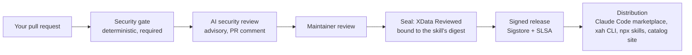

# Contributing

Thanks for helping build a trustworthy, portable agent toolkit. **Every skill in AgentHub is security-reviewed before it
is distributed — including yours.** That is the promise users rely on, so every contribution goes through the same
pipeline as the maintainers' own skills.

## How a contributed skill reaches users



1. **Security gate** (`scripts/skill_security_check.py`, required check): rejects executable content, hidden Unicode or
   HTML comments, piped downloads, encoded blobs, shortened links, prompt-injection and exfiltration phrasing, and
   skills without a Safety section.
2. **AI security review** (`scripts/ai_skill_review.py`): looks for subtle injection, unsafe advice, missing approvals,
   wrong technical or legal claims and EU fit. It is advisory and can never approve a skill by itself.
3. **Maintainer review**: a human reviews content, accuracy and fit with the [skill quality standard](docs/SKILL_QUALITY_STANDARD.md).
4. **Seal**: maintainers grant **XData Reviewed** (and, with evidence, **XData Verified** or **EU Ready**) in
   `registry/seals.json`. Seals are bound to the skill's package digest — any later change requires a new review.
5. **Distribution**: the next signed release, the Claude Code plugin marketplace and the catalog site pick it up.

## Submit a skill

1. Optional but welcome: open a [skill proposal](https://github.com/XData-si/xdata-agenthub/issues/new?template=skill_request.yml)
   to agree on scope first.
2. Follow the `skill-authoring` skill: `skills/<id>/SKILL.md` with `name`, a description that says **what and when**,
   procedure, example fixture, acceptance checks with a negative case, and a **Safety** section. Instructions only — no
   scripts, binaries or download links.
3. Add the entry to `registry/catalog.json` and `docs/CATALOG.md`, and the skill path to a topic bundle in
   `.claude-plugin/marketplace.json`.
4. Run locally:
   ```bash
   python3 scripts/skill_security_check.py <id>
   python3 scripts/update_digests.py
   python3 -m unittest discover -s tests
   python3 cli/xah.py doctor
   ```
5. Open a pull request using the template. Do not add seals yourself — maintainers grant them.

## Rules
- Submit original content or material with clearly compatible redistribution rights (MIT for bundled skills), and
  disclose inspiration and sources.
- Never submit secrets, copied proprietary prompts, obfuscated commands or install scripts.
- Keep pull requests focused: one skill or one change per pull request.
- Security issues in AgentHub itself: report privately (see [SECURITY.md](SECURITY.md)), not in public issues.

## Other contributions
Bug fixes, CLI improvements, documentation and translations are welcome. Open an issue first for larger changes, keep
the CLI dependency-free and offline-first, and add tests.
