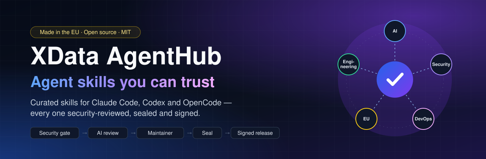
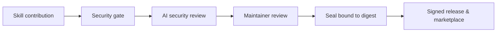

<p align="center"><a href="https://xdata-si.github.io/xdata-agenthub/"></a></p>
<h3 align="center">Give your AI coding agent 104 security-reviewed skills in minutes.</h3>
<p align="center"><a href="https://xdata-si.github.io/xdata-agenthub/"><b>Browse the catalog</b></a> · <a href="#install-in-one-command">Install</a> · <a href="CONTRIBUTING.md">Contribute a skill</a> · <a href="docs/SEAL.md">Seal of approval</a></p>

# XData AgentHub

**One place. Every agent capability.**

> Discover, inspect and install portable AI agent instructions, skills and workflow templates. Open source, vendor-neutral, and security-conscious.

[](#roadmap) [](LICENSE) [](https://xdata.si)

**Curated, security-reviewed agent skills for real engineering work** — 104 original skills for Claude Code, Codex, OpenCode and any client that reads the [Agent Skills](https://agentskills.io/specification) format.

[](docs/CATALOG.md) [](https://agentskills.io/specification) [](https://github.com/XData-si/xdata-agenthub/actions/workflows/test.yml)

[](https://github.com/XData-si/xdata-agenthub/releases) [](docs/VERIFYING.md) [](docs/VERIFYING.md#3-build-provenance-slsa-attestation) [](docs/VERIFYING.md) [](docs/SEAL.md) [](docs/EU_SOVEREIGNTY.md) [](docs/SEAL.md) [](https://scorecard.dev/viewer/?uri=github.com/XData-si/xdata-agenthub)

## Install in one command

| Client | Command |
|---|---|
| **Claude Code** (plugin marketplace) | `/plugin marketplace add XData-si/xdata-agenthub` then `/plugin install xdata-agenthub@xdata-agenthub` |
| Claude Code, topic bundles only | `/plugin install xdata-security@xdata-agenthub` · `xdata-engineering` · `xdata-ops` · `xdata-ai` |
| **Any agent** via the community `skills` CLI | `npx skills add XData-si/xdata-agenthub` — discovers the `skills/` directory; not yet verified by maintainers |
| **Codex, OpenCode, Claude Code** without Node | `python3 cli/xah.py add <skill> --agent codex --scope user` (see [Quick start](#quick-start)) |

Start with `agenthub-router`: it picks the right skill (or a short sequence) for the task and reports each skill's acceptance checks.

## See it work

The same short script, reviewed by Claude Code with the `shell-script-review` skill loaded natively (from our recorded
[runtime evidence](docs/integration-evidence/2026-10-28-runtime-results.md)):

```sh
#!/bin/sh
rm -rf $BUILD_DIR/*
for f in `ls *.log`; do
  eval "gzip $f"
done
```

The agent followed the skill's procedure and reported, with line numbers: an unguarded, unquoted recursive delete that wipes the
file system root when the variable is empty (critical); command injection through `eval` on file names (critical); parsing
`ls` output (high); no error handling (high) — and stated that ShellCheck was **not run** instead of pretending it was.
That is the point of a skill: a consistent procedure, explicit evidence and honest limits, every time.

**Measured, not claimed.** In our [before/after demos](demos/) (3 tasks, 18 runs, rubric fixed in advance), a frontier
model found every planted issue with *and* without the skills. The difference was in how it worked: with the skill it
stated which tools were not run (3/3 vs 0/3), listed residual risks (3/3 vs 0/3) and asked for approval before a
production change (2/3 vs 0/3). Skills buy consistent process and honest reporting. We publish the runs where they
did not help, too.

## Why AgentHub

Public skill registries grew to hundreds of thousands of entries in 2026 — and became an attack surface: poisoned `SKILL.md` files on open marketplaces were used to trick agents and users into installing malware. AgentHub takes the opposite approach:

- **Small and curated, not scraped.** Every skill is original, MIT-licensed, reviewed in pull requests and listed with provenance in [`registry/catalog.json`](registry/catalog.json).
- **Instructions only.** No bundled scripts, no remote includes, no download links; CI rejects entries that break the [release gates](scripts/validate_release.py), and `xah audit` flags piped downloads.
- **Built to be verified.** Each skill has an example fixture, acceptance checks with negative cases and an explicit safety section, following the [skill quality standard](docs/SKILL_QUALITY_STANDARD.md).
- **Vendor-neutral and offline-first.** Plain Markdown in the open Agent Skills format; the `xah` CLI is dependency-free Python that never executes downloaded code.
- **Production topics.** Threat modeling, OAuth/OIDC, supply-chain provenance, EU AI Act readiness, SLOs, incident response, MCP servers, agent guardrails, local LLM serving — not just prompts.

Browse the [searchable catalog site](https://xdata-si.github.io/xdata-agenthub/), the [categorized catalog](docs/CATALOG.md) and the [honest comparison](docs/COMPARISON.md) with other skill hubs.

### Every skill is security-reviewed — including community contributions



No skill is distributed without passing the deterministic security gate, an AI security review and a maintainer review. Want to add yours? See [CONTRIBUTING.md](CONTRIBUTING.md) — your skill gets the same review and the same seal.

**Seal of approval:** every skill change passes a deterministic security gate and an AI review in CI; maintainers grant **XData Reviewed**, **XData Verified** (runtime evidence) and **EU Ready** seals that are bound to the skill's digest and expire on any change — see [docs/SEAL.md](docs/SEAL.md).

**Coming next — Verified MCP:** the same review, evidence and seals for MCP servers, plus tested skill + MCP bundles. See [docs/VERIFIED_MCP.md](docs/VERIFIED_MCP.md) and the [roadmap](ROADMAP.md).

**European by design:** made in the EU, no telemetry, works with EU-hosted or self-hosted models, and ships skills for GDPR, data sovereignty, the EU AI Act, NIS2 and the Cyber Resilience Act — see [docs/EU_SOVEREIGNTY.md](docs/EU_SOVEREIGNTY.md).

**Verify what you install:** every skill has a package digest in the catalog (`xah verify`), releases are signed with Sigstore and carry SLSA build provenance — see [docs/VERIFYING.md](docs/VERIFYING.md).

**Status: public alpha.** No certification or compatibility claims beyond the [recorded evidence](docs/integration-evidence/2026-10-15-runtime-results.md); skills are documentation-level drafts until marked Verified.

## Quick start

```bash
# Run from this directory; Python 3.10+
python3 cli/xah.py list
python3 cli/xah.py search review
python3 cli/xah.py doctor
mkdir -p /tmp/xah-demo
python3 cli/xah.py init --agent claude --profile developer --target /tmp/xah-demo --dry-run
python3 cli/xah.py init --agent claude --profile developer --target /tmp/xah-demo
python3 cli/xah.py inspect code-review
python3 cli/xah.py add mcp-review --agent claude --target /tmp/xah-demo
python3 cli/xah.py audit --target /tmp/xah-demo
```

Install the CLI to your user directory (no sudo):

```bash
bash scripts/install.sh
xah --help
```

## v0.3.0 (2026-10-29)

v0.3.0 is the first signed release: the archives, the catalog and `SHA256SUMS` are signed with Sigstore and carry
SLSA build provenance ([how to verify](docs/VERIFYING.md)). The release record is in the
[readiness checklist](docs/RC1_v0.3.0_READINESS.md#final-release-record-v030-2026-10-29) and the
[release notes](docs/RELEASE_NOTES_v0.3.0.md).

It also includes `xah browse`, `xah trust`, `xah release-check`, the shared adapter destination contract, and additional recovery tests. `browse` supports local catalog facets/pagination; `trust` reports **declared metadata only**, not verified publisher identity; `release-check` validates evidence-file structure, not reviewer authenticity. None of these commands downloads or executes third-party code.

Known limitations: rollback remains non-atomic across multiple files and its lock cannot prevent writes by unrelated processes.

## v0.2.0 development migration and operations

For safe v0.1.0-to-development migration, read the [migration guide](docs/MIGRATION_v0.2.0.md) and [operator runbook](docs/OPERATOR_RUNBOOK.md). They cover backups (including hidden files and manifests), conflict-safe updates, recovery, troubleshooting and release sign-off. **The v0.2.0 migration guide describes development behavior, not proof of a published release**; operator-accepted native compatibility evidence is recorded for Claude Code, Codex CLI and OpenCode, with documented provenance limitations and no independent source-trace audit. See [XAH-205 acceptance](docs/integration-evidence/XAH-205-ACCEPTANCE.md).

## Supported project layouts

| Target | Skill path | Guidance |
|---|---|---|
| Claude Code | `.claude/skills/` | `CLAUDE.md` |
| Codex | `.agents/skills/` | `AGENTS.md` |
| OpenCode | `.opencode/skills/` | `AGENTS.md` |

Skills can also be installed at user scope (`add --scope user`: `~/.claude/skills`, `~/.agents/skills`,
`~/.config/opencode/skills`), and private skills can live in [additional local catalogs](docs/ADDITIONAL_CATALOGS.md)
(`--catalog` / `XAH_CATALOGS`) without forking this repository.

See [compatibility details](docs/AGENT_COMPATIBILITY.md) and [demo storyboard](docs/SHOWCASE.md). These are path-level adapters, not full semantic conversions.

See the [categorized skill catalog](docs/CATALOG.md) for all entries and their intended uses.

## What's included
- **Skills**: reusable capabilities for code review, testing, API design, infrastructure, security and agent workflows; quality and depth vary by entry.
- **Instructions**: portable AGENTS.md starter for repositories.
- **Agents**: example agent roles, not running autonomous services.
- **Workflows**: transparent checklists for human-reviewed delivery.
- **Registry**: a small JSON index with provenance and local paths.
- **CLI**: local catalog browsing, search, inspection, declared-provenance trust reporting, add/init/update, recovery inspection and explicit rollback, doctor, heuristic audit and evidence checklist; local-first, standard-library Python.

## Design principles
1. Useful without registration, telemetry or a hosted service.
2. No remote shell pipelines, no hidden execution, no automatic code execution.
3. Explicit origin, license and risk review before third-party content is added.
4. Portable markdown first; adapter-specific support later.
5. No misleading star counters, fake usage statistics or inflated catalog counts.

## Roadmap
See [TODO.md](TODO.md), [ROADMAP.md](ROADMAP.md), [architecture](docs/ARCHITECTURE.md) and the [release process](docs/RELEASE_PROCESS.md).

## Community
See [CONTRIBUTING.md](CONTRIBUTING.md), [CODE_OF_CONDUCT.md](CODE_OF_CONDUCT.md) and [SECURITY.md](SECURITY.md). Contributions are welcome. See [Quickstart](docs/QUICKSTART.md) and [Launch checklist](docs/LAUNCH_CHECKLIST.md).

---

Maintained by [XData](https://xdata.si) · **Accessible premium AI engineering** · [Contact](https://xdata.si)
